# Student Record Management System (SRMS)

A full-stack **Advanced Java** project that lets an administrator **add, view, update, delete and search student records**.
It has two front ends that share one MySQL database:

* **Web application**: Java Servlets, JSP (JSTL + EL), Spring MVC with Spring Dependency Injection, and Hibernate ORM, with login, logout and `HttpSession` tracking
* **Desktop application**: a Swing GUI that uses plain JDBC (`PreparedStatement`)

Besides student records, the web application manages departments, courses and course enrollments with marks and automatically calculated grades (A+ to F), stored in five related tables with primary and foreign keys.

> Course: **Advance Java Technology (01CE0308)**, Department of Computer Engineering, Faculty of Engineering and Technology, Marwadi University
> Student: **Vats Kotadia (92610120001)**

| | |
|---|---|
| **GitHub repository** | https://github.com/aleeas33-33-33/student-record-management-system |
| **Live application** | _Link will be added after deployment_ <!-- LIVE_URL --> |
| **Default login** | `admin` / `admin123` |

## Contents
1. [Technologies and tools](#1-technologies-and-tools)
2. [Features](#2-features)
3. [Project structure](#3-project-structure)
4. [Database configuration and setup](#4-database-configuration-and-setup)
5. [Install and run](#5-install-and-run)
6. [Default logins](#6-default-logins)
7. [Testing](#7-testing)
8. [Screenshots](#8-screenshots)
9. [Author](#9-author)

---

## 1. Technologies and tools

| Layer | Technology |
|---|---|
| Language | Java 17 (built and tested with OpenJDK 21) |
| Web: controller | Java Servlets 4.0 (`LoginServlet`, `LogoutServlet`, `HealthServlet`), a Servlet Filter (`AuthFilter`), an `HttpSessionListener`, and Spring MVC 5.3 `@Controller`s |
| Web: view | JSP 2.3 with **JSTL** (`c:`, `fmt:`, `fn:`) and **EL**, no scriptlets; custom CSS; JavaScript validation |
| Dependency Injection | Spring Framework 5.3.39 (`@Configuration`, `@ComponentScan`, `@Service`, `@Repository`, `@Autowired`, constructor injection) |
| ORM | Hibernate ORM 5.6.15 (`SessionFactory`, HQL, `@Entity`, `@ManyToOne`, `@OneToMany`), HikariCP 4.0.3 connection pool |
| Validation | Bean Validation (Hibernate Validator 6.2.5) on the server, HTML5 + JavaScript on the client |
| Desktop | Java Swing (Nimbus look and feel), JDBC with `PreparedStatement` |
| Database | MySQL 8 / MariaDB 10.6+ (tested on MariaDB 11.8), MySQL Connector/J 8.4.0 |
| Server | Apache Tomcat 9 (`javax.*` namespace; tested on 9.0.124) |
| Build | Apache Maven 3.9 |
| Deployment | Docker (Tomcat 9 + embedded MariaDB), Render free web service (`render.yaml`) |
| Testing | Headless Chrome (Playwright), curl, Xvfb + `java.awt.Robot` for the Swing client |
| Version control | Git and GitHub |

## 2. Features

**Web application**
- Admin **login** (`LoginServlet`) with SHA-256 password check and server-side validation, a fresh session on every login (prevents session fixation), and **logout** (`LogoutServlet`)
- **Session management:** `AuthFilter` protects every page and sends no-cache headers, so after logout the old session cannot be reused and the browser's Back button returns to the login page. The dashboard shows the logged-in user, login time, session ID, creation and last-access time, timeout, pages viewed and active sessions (`HttpSessionListener`). A "last user" cookie is set at login.
- **Students:** full CRUD (create, list, view, edit, delete) plus search by name, enrollment number, email or city, and filters by department and year
- **Departments:** add, edit and delete. A department that still has students or courses cannot be deleted (foreign key).
- **Courses:** add and delete, and **course enrollment with marks**, where the grade is calculated automatically (A+ to F)
- **Validation:** HTML5 + JavaScript on the client, and Bean Validation plus business rules on the server (duplicate enrollment number or email, records still in use), with clear messages on every field
- Friendly error pages (404, 500, database errors through `@ControllerAdvice`)
- Navigation bar that connects the Dashboard, Students, Add Student, Departments and Courses pages
- Health-check URL `/health` (`HealthServlet`), used by Render

**Desktop application (Swing + JDBC)**
- Login screen that checks the same `users` table, and a Logout button
- `JTable` of all students, with search (name, enrollment number, email, city or department; Search button or Enter) and Show All
- Add, update, delete and clear form with input validation dialogs
- Friendly handling of SQL errors (duplicate key, foreign key, no connection)

## 3. Project structure

```
srms/
├── database/
│   ├── schema.sql            # CREATE DATABASE srms_db, 5 related tables, seed data
│   └── create_user.sql       # optional MySQL user srms_user
├── srms-web/                 # Maven WAR: Servlet/JSP/Spring/Hibernate web app
│   └── src/main/
│       ├── java/com/srms/
│       │   ├── config/       # AppConfig, HibernateConfig, WebConfig (Spring Java config)
│       │   ├── model/        # @Entity: User, Department, Course, Student, Enrollment
│       │   ├── dao/          # @Repository DAO interfaces + Hibernate implementations
│       │   ├── service/      # @Service business logic + @Transactional
│       │   ├── controller/   # Spring MVC @Controllers + GlobalExceptionHandler
│       │   ├── web/          # LoginServlet, LogoutServlet, HealthServlet, AuthFilter, SessionTrackingListener
│       │   └── util/         # PasswordUtil (SHA-256)
│       ├── resources/db.properties
│       └── webapp/           # WEB-INF/web.xml, JSP views, static css/js
├── srms-desktop/             # Maven JAR: Swing + JDBC client
│   └── src/main/java/com/srms/desktop/{db,dao,model,ui,util}
├── deploy/                   # docker-entrypoint.sh, low-memory MariaDB config
├── docs/                     # screenshots, ER diagram, DB evidence, test report and logs
├── Dockerfile                # Tomcat 9 + WAR + embedded MariaDB
└── render.yaml               # Render free-tier blueprint
```

## 4. Database configuration and setup

The database is `srms_db`, with 5 InnoDB tables:

| Table | Primary key | Foreign keys |
|---|---|---|
| `users` | `user_id` | none |
| `departments` | `dept_id` | none |
| `courses` | `course_id` | `dept_id` → `departments(dept_id)` |
| `students` | `student_id` | `dept_id` → `departments(dept_id)` |
| `enrollments` | `enrollment_id` | `student_id` → `students(student_id)` (ON DELETE CASCADE), `course_id` → `courses(course_id)` |


```bash
# 1. create the database, tables and seed data
#    (2 users, 4 departments, 6 courses, 8 students, 11 enrollments)
mysql -u root -p < database/schema.sql
# 2. (optional) create the application user srms_user / srms@123
mysql -u root -p < database/create_user.sql
```

> **Note:** `schema.sql` starts with `DROP DATABASE IF EXISTS srms_db;`, so running it again resets all data to the seed data.

The connection settings live in `srms-web/src/main/resources/db.properties` and `srms-desktop/src/main/resources/db.properties`
(default `jdbc:mysql://localhost:3306/srms_db`, user `srms_user`, password `srms@123`).
You can override all of them **without rebuilding** by setting these environment variables (or `-D` JVM options):

| Variable | Meaning | Example |
|---|---|---|
| `DB_URL` | JDBC URL | `jdbc:mysql://localhost:3306/srms_db?useSSL=false&allowPublicKeyRetrieval=true&serverTimezone=Asia/Kolkata` |
| `DB_USER` | Database user | `root` |
| `DB_PASSWORD` | Password | `your-password` |
| `PORT` | HTTP port (Docker image only) | `8080` by default; Render sets its own |

## 5. Install and run

**Prerequisites:** JDK 17+, Maven 3.9+, MySQL 8 or MariaDB 10.6+, Apache Tomcat 9.x (Tomcat 9, not 10, because the app uses the `javax.*` namespace) and Git.

```bash
git clone https://github.com/aleeas33-33-33/student-record-management-system.git
cd student-record-management-system
```
Create the database first (section 4), then build and run either application.

### Web application (Tomcat 9)
```bash
cd srms-web
mvn clean package                  # produces target/srms.war
cp target/srms.war $CATALINA_HOME/webapps/
export DB_USER=root DB_PASSWORD=yourpassword     # only if not using srms_user
$CATALINA_HOME/bin/startup.sh
# open http://localhost:8080/srms/login
```

### Desktop application (Swing)
```bash
cd srms-desktop
mvn clean package                  # produces target/srms-desktop-jar-with-dependencies.jar
java -jar target/srms-desktop-jar-with-dependencies.jar
# with other DB credentials:
java -DDB_USER=root -DDB_PASSWORD=yourpassword -jar target/srms-desktop-jar-with-dependencies.jar
```

### Docker (single container, the same image used for deployment)
```bash
docker build -t srms .
docker run -p 8080:8080 srms        # embedded MariaDB is seeded from database/schema.sql
# open http://localhost:8080/login
```
In the container the app is deployed at the root path (`/login` instead of `/srms/login`).
When `DB_URL` is **not** set, the container starts its own MariaDB and loads `database/schema.sql` and `database/create_user.sql`.
When `DB_URL`, `DB_USER` and `DB_PASSWORD` are set, it connects to that external MySQL instead.
The image reads `PORT` (default `8080`; Render sets it automatically).

### Deploy on Render (free)
1. Push this repository to GitHub.
2. On Render, choose **New → Blueprint** (it uses `render.yaml`), or **New → Web Service → Docker**, and select the repository.
3. Instance type: **Free**. No disk and no paid database are needed. The health check path is `/health`.
4. Open the generated URL and log in with the default account below.

Note: the embedded database resets to the seed data whenever the free instance restarts or redeploys, and the first request after a period of inactivity can take up to a minute while the free instance wakes up.

## 6. Default logins

| Username | Password | Role |
|---|---|---|
| `admin` | `admin123` | ADMIN |
| `faculty` | `faculty123` | ADMIN |

Passwords are stored as SHA-256 hashes (`SHA2('admin123',256)`).

## 7. Testing

All results come from real runs; see [`docs/TEST_REPORT.md`](docs/TEST_REPORT.md) and the logs in [`docs/`](docs/).

| Area | Checks | Result |
|---|---|---|
| Web UI (headless Chrome) | login, client and server validation, CRUD, search, FK rules, 404, logout | 22 / 22 passed |
| HTTP and session (curl) | redirects, 401 on wrong password, new session ID, logout, old session rejected | 6 / 6 passed |
| Swing desktop (Xvfb) | login, JDBC insert/read/update/delete, search, validation, SQL errors | 10 / 10 passed |

The Docker image was not built on the development machine (Docker is not installed there); its first build runs on Render.

## 8. Screenshots

| | |
|---|---|
| Login, client-side validation |  |
| Dashboard with session tracking |  |
| Student list | 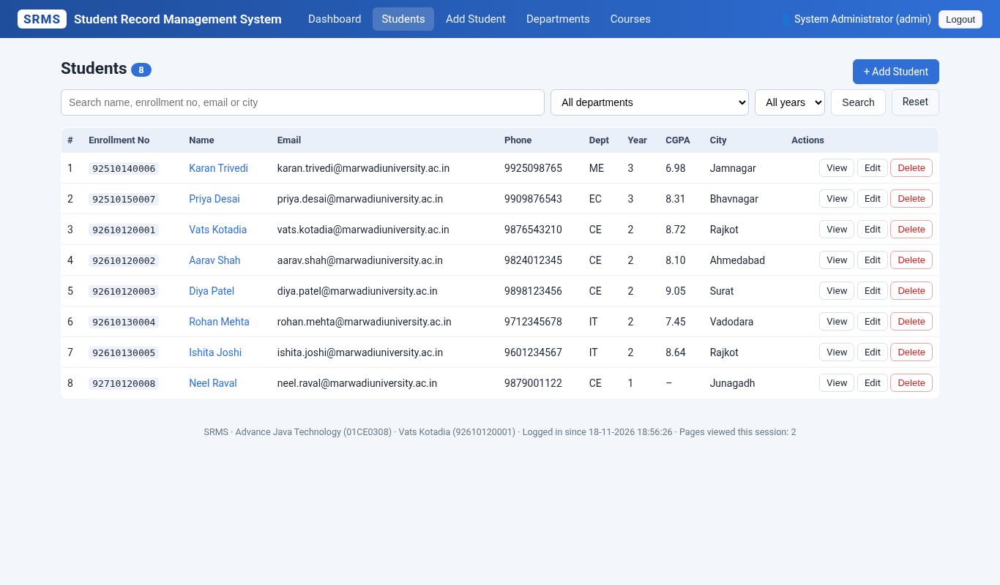 |
| Search |  |
| Add student, client-side validation | 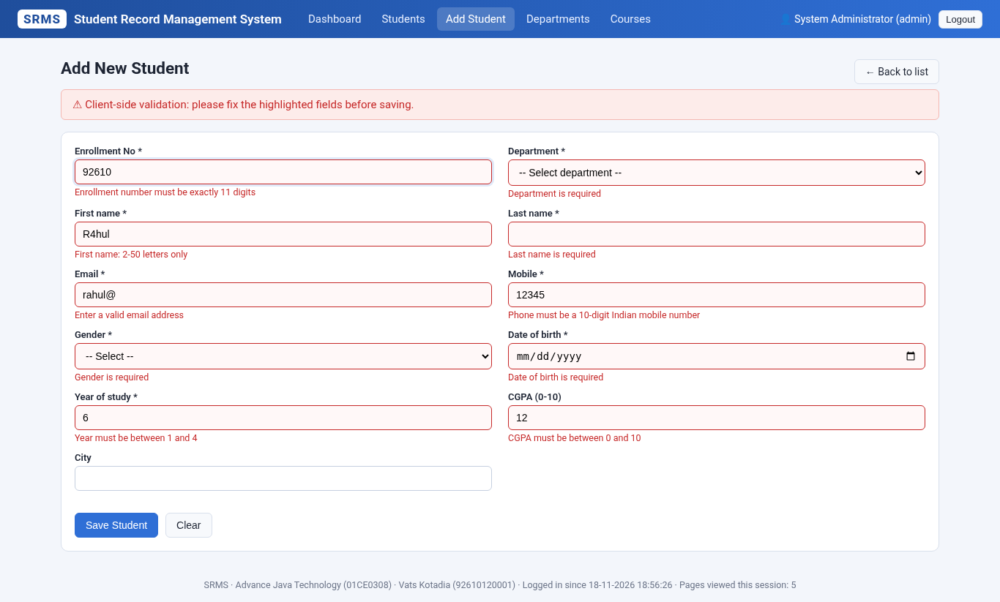 |
| Add student, server-side validation | 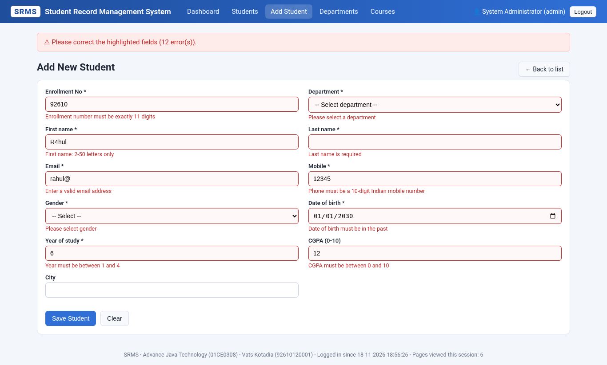 |
| Student added | 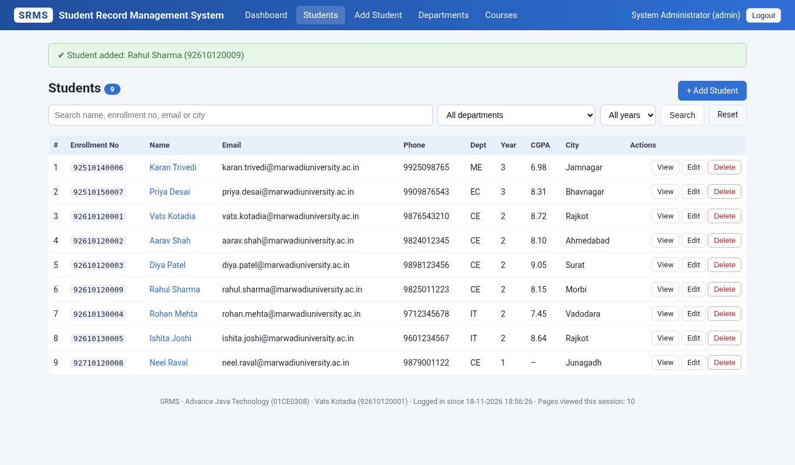 |
| Student details and course marks | 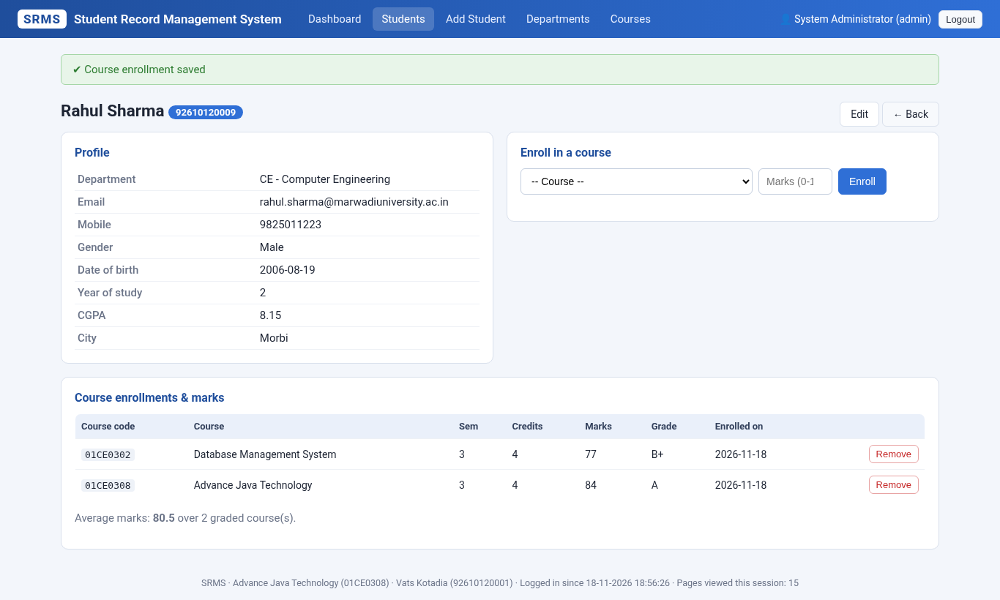 |
| Update | 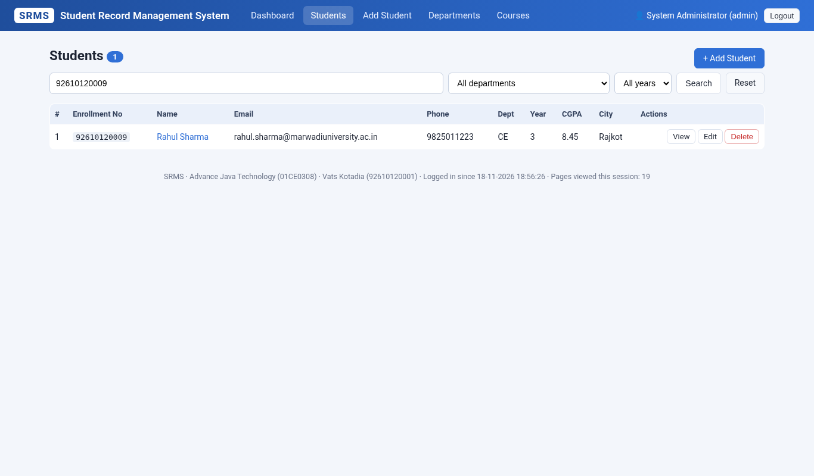 |
| Delete |  |
| Department in use (FK) | 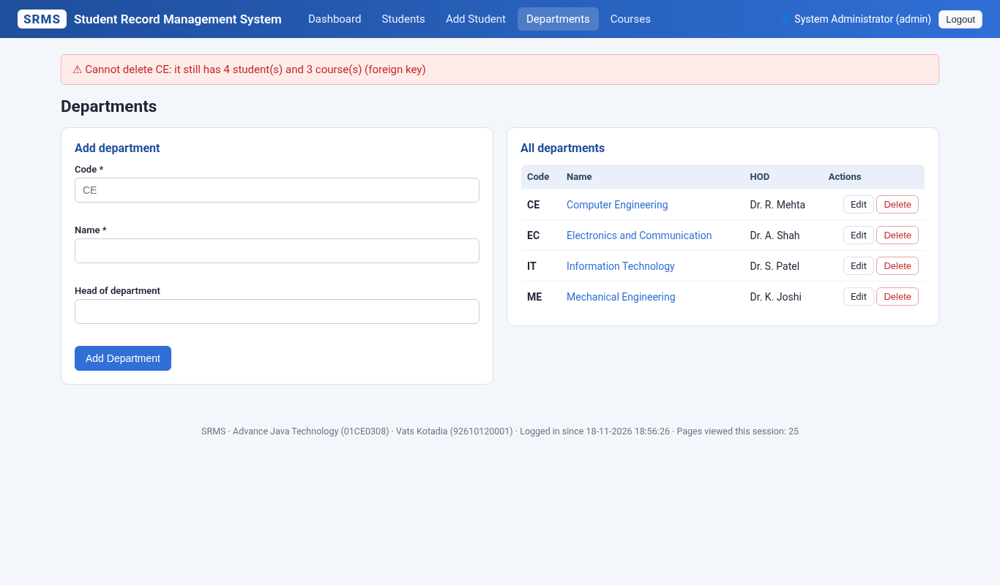 |
| Courses | 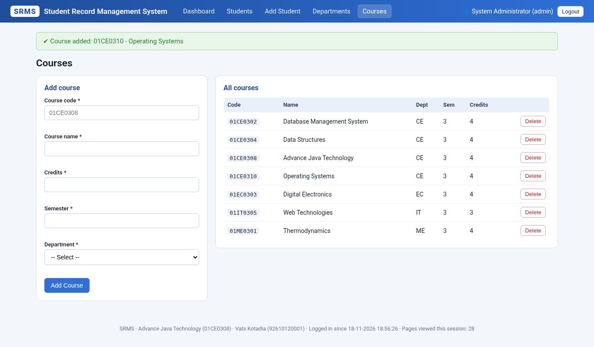 |
| Logout | 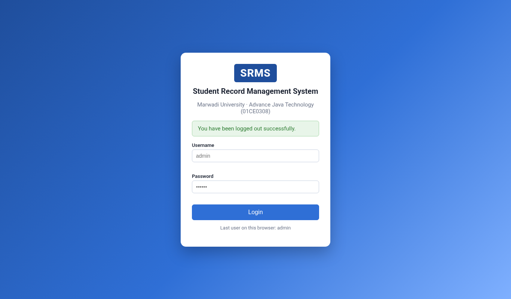 |
| Swing login | 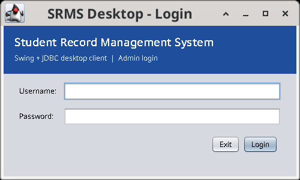 |
| Swing JTable | 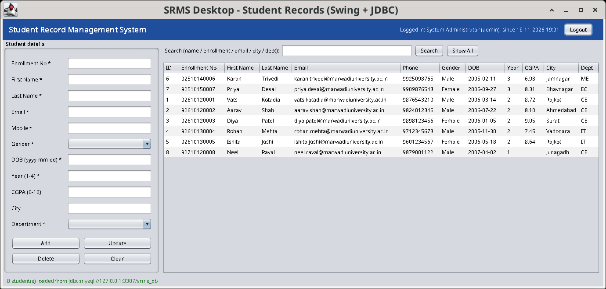 |
| Swing validation |  |
| Swing add |  |
| Swing duplicate key (SQLException handled) | 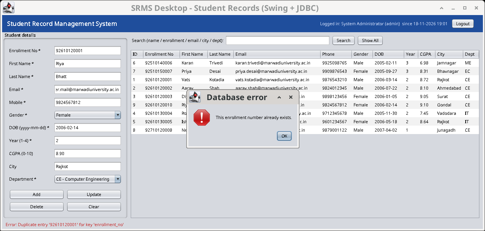 |

All screenshots are in [`docs/screenshots/`](docs/screenshots/).

## 9. Author

**Vats Kotadia** (Enrollment No. 92610120001), B.Tech Computer Engineering, Marwadi University.
